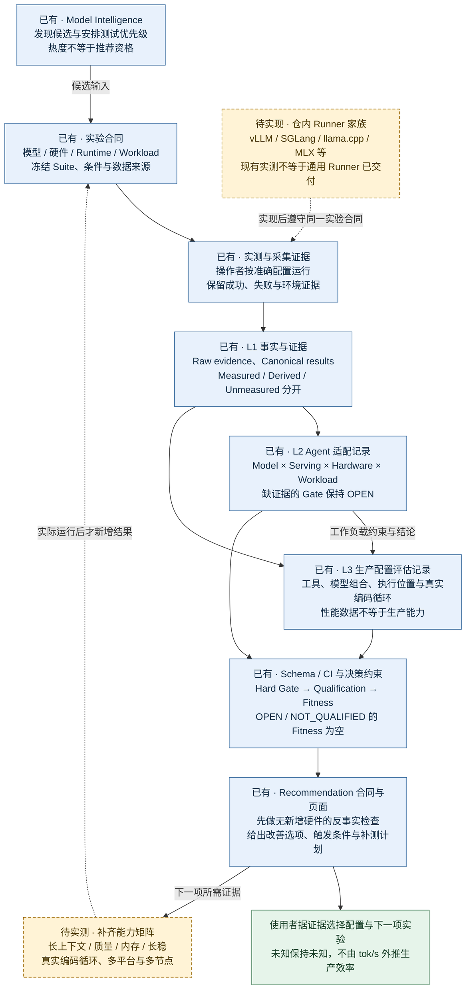

# Local LLM Cross-Platform Benchmark

一个长期维护、可复现、以真实硬件实测为核心的本地大模型（Local LLM）跨平台能力数据库。

本仓库不只比较 `tokens/s`。目标是记录同一模型在不同真实硬件、操作系统、推理栈、量化、上下文长度和工作负载下的 **质量、性能、内存、稳定性、效率与可复现证据**，并在事实层之上形成可审计的 Agent 适配与大型编码生产决策。

## 先看这里：人类可读 Decision Dashboard

如果你是来判断“这台机器到底好不好用、适合什么 Agent、适不适合大型编码、下一步该怎么升级”，**不要先打开 `assessments/*.json` 或 `recommendations/*.json`**。JSON 是给程序、CI 和自动推荐器使用的机器底座。

直接从下面的人类页面进入：

| 入口 | 回答的问题 |
| --- | --- |
| **[三层 Decision Dashboard](docs/decision-system/dashboard.md)** | L1 / L2 / L3 当前状态一页看完 |
| **[L1 — 性能 / 稳定性完整结果](docs/results/qwen38-27b-gx10-20260903.md)** | 真实测出了什么 |
| **[L2 — 当前 GX10 Agent 适配度](docs/decision-system/current-gx10-agent-fitness.md)** | 适合 Coding Worker、Repo Analyst、RAG、多 Agent、7×24 吗 |
| **[L3 — 当前大型编码生产适配度](docs/decision-system/current-gx10-production-fitness.md)** | 能不能承担高强度大型项目 Coding Production |
| **[Model Intelligence 人类视图](docs/decision-system/model-intelligence-view.md)** | 经典 / 旗舰 / 生产甜点 / 编码专家 / 长上下文专家 / 热门模型怎么选 |
| **[当前改善 / 补测 / 硬件升级路线](docs/decision-system/current-gx10-roadmap.md)** | 现在优化什么、什么时候才值得加第二节点 |

机器可读文件仍然完整保留在 `results/`、`assessments/`、`model-intelligence/`、`recommendations/`，用于追证据、Schema 校验和后续自动生成页面。

## 当前已验证实测结果

> 当前首页展示的是已进入 `results/` canonical result 的 GX10 Formal100 **部分 suite 数据**：32,768 input + 256 output、Concurrency=1、1 次 warmup 后主批次。它不是 frozen suite 的 cold-cache 完整 isolation，也不是仓库固定定义的 `E2E@32K`（32,768 input + 32,768 output）。

<!-- BEGIN AUTO:FORMAL100_DASHBOARD -->
| Hardware | Model | Precision | Workload | Cache | Mode | Evidence | Effective Prefill* (tok/s) | Pure Prefill (tok/s) | TTFT (ms) | TPOT (ms/token) | Decode (tok/s) | E2E (ms) | Completion | 详情 |
| --- | --- | --- | --- | --- | --- | --- | ---: | ---: | ---: | ---: | ---: | ---: | --- | --- |
| 1× GX10 / GB10 | Qwen3.8-27B | BF16 | 32K + 256 | warm (1 warmup) | platform_optimized | B | 936.453 | 未单独测 | 34991.596 | 252.447 | 3.961 | 99365.625 | 100/100 | [完整详情](docs/results/qwen38-27b-gx10-20260903.md#formal100-performance) |
| 1× GX10 / GB10 | Qwen3.8-27B | FP8 | 32K + 256 | warm (1 warmup) | platform_optimized | B | 1187.130 | 未单独测 | 27602.710 | 156.783 | 6.378 | 67582.360 | 100/100 | [完整详情](docs/results/qwen38-27b-gx10-20260903.md#formal100-performance) |
| 1× GX10 / GB10 | Qwen3.8-27B | NVFP4 | 32K + 256 | warm (1 warmup) | platform_optimized | B | 1300.614 | 未单独测 | 25194.249 | 110.122 | 9.081 | 53275.252 | 100/100 | [完整详情](docs/results/qwen38-27b-gx10-20260903.md#formal100-performance) |
<!-- END AUTO:FORMAL100_DASHBOARD -->

\* `Effective Prefill* = 32768 / TTFT(s)`，是 Derived 的实际首 token 链路有效输入速度，**不是 Pure Prefill `pp_tps`**。Pure Prefill 本轮没有独立测量，因此保持“未单独测”。

这张首页表由 `results/qwen38-27b-v1.0/gb10-01/*.json` 的 canonical Formal100 结果生成/校验；CI 会阻止 README 数字与结构化结果静默漂移。

**看不懂 Prefill / TTFT / TPOT / Decode / E2E / Std / P99 / CV？** 统一看：[Benchmark 指标统一解释](docs/metrics/benchmark-metrics-glossary.md)。

### 这一轮的数据资产

- **Canonical Results**：[BF16 / FP8 / NVFP4 Formal100 + NVFP4 failed B0](results/qwen38-27b-v1.0/gb10-01/)
- **指标统一解释**：[Measured / Derived / Unmeasured、Prefill、TTFT、TPOT、Decode、E2E、ITL、Std、CV、P50-P99、Peak output、throughput、drift](docs/metrics/benchmark-metrics-glossary.md)
- **衍生数据与决策结论**：[相对收益、单请求节省时间、100 请求成本、requests/hour、E2E 阶段占比、瓶颈迁移、tail、可重复性](docs/results/qwen38-27b-gx10-derived-analysis-20260903.md)
- **Formal5（5 次）阶段数据**：[三档横向表 + BF16 多轮 Formal5](docs/results/qwen38-27b-gx10-20260903.md#formal5-performance)
- **Formal100（100 次）正式 warm-batch 性能**：[runner 参数、均值、duration、Completion、Effective Prefill / Decode / E2E](docs/results/qwen38-27b-gx10-20260903.md#formal100-performance)
- **Formal100 批次稳定性**：[Std / CV / P50 / P90 / P95 / P99 / ITL / Formal5→100 drift](docs/results/qwen38-27b-gx10-20260903.md#formal100-stability)
- **FP8 / NVFP4 Runtime + Hardware Gate**：[checkpoint → runtime → inference → Nsys → NCU → Tensor Pipe](docs/results/qwen38-27b-gx10-20260903.md#runtime-gates)
- **失败与诊断过程**：[NVFP4 B0 Bad Gateway、BF16 diagnostics、kernel trace](docs/results/qwen38-27b-gx10-20260903.md#failure-evidence)
- **最终结论与边界**：[哪些成立、哪些仍必须新增实测](docs/results/qwen38-27b-gx10-20260903.md#conclusions)
- **原始证据入口**：[Formal/B0/Diagnostics/Gates/Manifest/History](docs/results/qwen38-27b-gx10-20260903.md#raw-evidence-index)
- **结果资产审计清单**：[本轮测试、证据、结构化结果、修复项与缺口](docs/results/qwen38-27b-gx10-asset-inventory-20260903.md)

## Decision System v1

Benchmark 事实之上新增三层决策体系，但不改变 L1 的证据边界：

图中区分三种事实：**已有**的合同、工具和记录；**待实现**的 Runner；以及已有方法但**待实测**的工作负载。L2 / L3 的记录与校验器已经存在，不等于目标工作负载已获生产资格。



当前 L1 正式结果只覆盖上方说明的 GX10 Formal100 部分 Suite；图中的完整链路不把未测质量、多节点或生产任务当作通过。`T` 是补测工作，不能与 `X` 的代码待实现混为一谈。新增实验由操作者安排，当前没有自动派发或自动采购系统。设计依据：[Decision System v1](docs/decision-system/README.md) · [Runner 合同](runners/README.md) · [方法论](docs/methodology.md)。


- **L1 — FACT**：只回答真实测到了什么；
- **Model Intelligence**：维护经典/旗舰/生产甜点/编码/长上下文/热门候选，只负责候选发现，不直接产生生产推荐；
- **L2 — Agent Workload Fitness**：评价 `Model Variant × Serving Profile × Hardware Topology × Agent Workload Contract`；
- **L3 — Coding Production Fitness**：评价 Coding Tool、Model Portfolio、Inference/Workspace/Build/Test Placement、AI Node、开发主机、Storage/Authority、真实 Coding Loop 的完整生产配置；
- **Recommendation**：L2/L3 的统一输出合同，不是第四层；硬件购买前必须先做 No-Hardware Counterfactual Check。

关键规则：`Hard Gate → Qualification → Fitness → Recommendation`，禁止用一个加权总分掩盖未知或硬失败。`OPEN / NOT_QUALIFIED` 时 Fitness 必须为空。Popularity 只影响测试优先级，不能当 Quality/Hardware Fit/Production Fit。

### 人类页面

- [三层 Decision Dashboard](docs/decision-system/dashboard.md)
- [Decision System v1 总纲](docs/decision-system/README.md)
- [L2：当前 1×GX10 + Qwen3.8-27B NVFP4 Agent 适配度](docs/decision-system/current-gx10-agent-fitness.md)
- [L3：当前高强度大型项目 Coding Production 适配度](docs/decision-system/current-gx10-production-fitness.md)
- [Model Intelligence：经典/旗舰/甜点/专家/热门模型视图](docs/decision-system/model-intelligence-view.md)
- [当前改善/补测/硬件升级路线](docs/decision-system/current-gx10-roadmap.md)

### 机器记录（程序 / CI / 自动推荐器）

- [Model Intelligence Registry JSON](model-intelligence/registry.json)
- [L2 Agent Assessment JSON](assessments/agent/gx10-qwen38-nvfp4-32k-v1.json)
- [L3 Large Coding Production Assessment JSON](assessments/production/gx10-qwen38-nvfp4-large-coding-v1.json)
- [Upgrade / Next-test Recommendation JSON](recommendations/gx10-qwen38-nvfp4-roadmap-v1.json)

CI 会编译并执行 `scripts/validate_decision_system.py`，检查 Schema、Hard Gate/Qualification/Fitness 语义、禁止 aggregate score、Model Intelligence 推荐资格、Hardware ACTION 的反事实门槛、本地 evidence 引用与 freshness 顺序。

后续 128K / 256K / 384K / 512K / 768K / 1M、32K-output E2E、Pure Prefill、Peak Memory/KV、cold-cache isolation、质量、24h soak、PRO 6000、2×/4× GB10、Apple / AMD 等完成后，继续追加；没有可靠实测的数据保持“未测 / 不可计算”。

## 核心原则

1. **主结果只来自真实拥有并实际运行过的硬件。** `planned` 仅表示未来可能接入，不进入正式结果或排名。
2. **同一把尺子跨平台复用。** NVIDIA、Apple，以及未来实际购入的 AMD / Intel / 其他平台，尽可能使用同一测试母本、同一结果合同与同一证据等级。
3. **不把“配置上限”当“实测能力”。** `Actual Context` 必须是实际完成测试的上下文长度。
4. **失败也是结果。** OOM、崩溃、early-EOS、乱码、重复输出、长上下文失效都应保留证据。
5. **历史结果不静默覆盖。** 测试方法变化通过新 suite/version 发布；旧数据可标记 `superseded` / `invalidated`，但不篡改历史。
6. **平台公平层与平台最优层分开。** 前者尽量控制变量，后者允许各平台使用自身最优 runtime/kernel/量化。
7. **模型权重、Token、代理配置、私有数据和受限制 benchmark 原题不进入公共仓库。**
8. **Recommendation ≠ Buy Hardware。** 配置、runtime、context strategy、模型替换、routing、role reassignment 必须先于大额硬件替换做反事实检查。

## 实验维度

至少记录：Hardware、Node Topology、OS、Driver/Compute Stack、Model Revision、Weight Precision、KV Precision、Runtime、Optimization Stack、Actual Context、Output Length、Reasoning/Sampling、Cache State、Concurrency、Workload、Test Date。

## 核心指标

- Prefill / PP tok/s
- TTFT (Time To First Token)
- Decode / TG tok/s
- E2E@32K
- Peak Memory / KV Cache / Host Memory
- Quality（Reasoning / Coding / Instruction / Long Context / Agent）
- Stability / Reliability
- Power / Thermals（可测时）
- Scaling Efficiency（多节点时）

`E2E@32K` 固定定义：**32,768 input tokens + 32,768 output tokens、Concurrency=1、Cold Cache**，从请求发出到最后一个 token 完整接收。未生成满 32,768 tokens 不得填写成功值。

## 第一套正式 Suite

`suites/qwen38-27b/v1.0/`

第一阶段比较：

- Qwen3.8-27B BF16
- Qwen3.8-27B FP8
- Qwen3.8-27B NVFP4
- 1× GB10
- RTX PRO 6000 96GB
- 后续实际到手的 Mac / 2×GB10 / 其他硬件按同一合同追加

Context 轴：`32K / 128K / 256K / 384K / 512K / 768K / 1M`。

质量与工作测试核心包含：GPQA Diamond、IFBench、HumanEval+、LiveCodeBench、LongBench v2、Needle-in-a-Haystack、NoLiMa，以及固定 exact-token 性能与 32K 长输出稳定性工作负载。

## 仓库结构

```text
docs/              方法论、指标、结果详情、Decision System
hardware/          硬件 registry 与已实测设备 profile
suites/            每个模型/版本的冻结测试套件
datasets/          数据集 manifest 与获取规则（不保存受限原题）
runners/           vLLM / SGLang / llama.cpp / MLX 等 runner
schemas/           Benchmark + Decision System 结构化合同
results/           通过 schema 的正式结构化 benchmark 结果
evidence/          可公开的原始日志、环境快照与校验信息
model-intelligence/模型候选/角色/生命周期输入面
assessments/        L2 Agent / L3 Production machine-readable assessments
recommendations/    可审计 recommendation + trigger + next-test plan
scripts/            下载、校验、采集、汇总、dashboard 与 validator
```

## Evidence Levels

- **A — Fully Reproducible**：完整参数、版本、环境快照、测试数据 hash、原始日志、结构化结果均存在。
- **B — Verified**：关键条件可验证，但少量 A 级要求仍缺失；必须展示证据缺口。
- **C — Community Reference**：第三方论坛/GitHub/社区数据，仅作为外部参考，不与本仓库主实测等权。

详见 `docs/evidence-levels.md`。

## License 与第三方数据

本仓库自有代码和文档按仓库 License 发布；第三方模型、数据集、benchmark 与其题目内容仍受各自许可证/访问条款约束。仓库中的 manifest、下载说明或 hash 不代表重新授权第三方内容。
